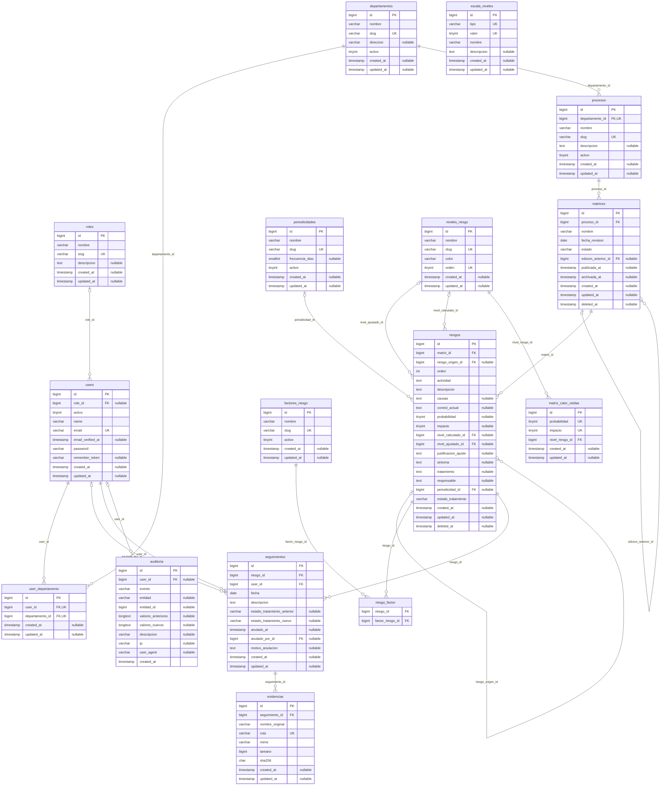

# Diagrama entidad-relación (ERD)

Base de datos del Sistema de Gestión de Matrices de Riesgo (entregable del
documento de requisitos). Generado a partir del **esquema real** de MariaDB
tras aplicar todas las migraciones (15/10/2026); no es un dibujo aparte.

## Vista general

```text
roles ──< users >──< departamentos ──< procesos ──< matrices ──< riesgos ──< seguimientos ──< evidencias
                (user_departamento)                    │  ↺          │  ↺ riesgo_origen
                                                       │ edición     ├──< riesgo_factor >── factores_riesgo
                                                       │ anterior    ├── periodicidades
                                                       │             └── niveles_riesgo (calculado / ajustado)
niveles_riesgo ──< matriz_calor_celdas      escala_niveles      auditoria (registro de cambios de todo)
```

- Un **departamento** tiene **procesos**; cada proceso tiene **ediciones de su
  matriz** (borrador → vigente → archivada), encadenadas por
  `edicion_anterior_id`.
- Cada edición tiene **riesgos** (filas del formulario RT-01-NI-ONA-156). Al
  crear una edición nueva, cada riesgo copiado apunta a su original
  (`riesgo_origen_id`): así se comparan ediciones.
- El **nivel** de un riesgo se calcula con la **matriz de calor**
  (Probabilidad × Impacto → nivel); un ajuste manual se guarda aparte
  (`nivel_ajustado_id` + justificación) sin perder el calculado.
- Los **seguimientos** son un histórico (no se editan; se anulan con motivo)
  y pueden tener **evidencias** adjuntas.

## Diagrama



Claves: **PK** clave primaria · **FK** clave foránea · **UK** valor único
(en `user_departamento` y `riesgo_factor`, la combinación de las dos columnas).

## Tablas

| Tabla | Para qué | Claves foráneas | Únicos |
|---|---|---|---|
| `roles` | Roles fijos del sistema (Administrador, Encargado de Departamento, Encargado de Seguimiento, Auditor, Dirección). | — | (slug) |
| `users` | Usuarios. Sin borrado: se desactivan (`activo`). Contraseña cifrada (bcrypt). | `role_id` → `roles` | (email) |
| `user_departamento` | Departamentos asignados a cada usuario (alcance de los encargados). | `departamento_id` → `departamentos`, `user_id` → `users` | (user_id, departamento_id) |
| `departamentos` | Departamentos / direcciones. Sin borrado: se desactivan. | — | (slug) |
| `procesos` | Procesos de cada departamento; cada proceso tiene su matriz. | `departamento_id` → `departamentos` | (departamento_id, slug) |
| `matrices` | Ediciones de la matriz de un proceso (borrador → vigente → archivada). Una vigente y una archivada son inmutables. `edicion_anterior_id` enlaza la cadena de ediciones. | `edicion_anterior_id` → `matrices`, `proceso_id` → `procesos` | — |
| `riesgos` | Filas de la matriz (los 13 campos del formulario RT-01-NI-ONA-156). `riesgo_origen_id` enlaza con el mismo riesgo en la edición anterior (comparación). | `matriz_id` → `matrices`, `nivel_ajustado_id` → `niveles_riesgo`, `nivel_calculado_id` → `niveles_riesgo`, `periodicidad_id` → `periodicidades`, `riesgo_origen_id` → `riesgos` | — |
| `riesgo_factor` | Factores de cada riesgo (un riesgo puede tener varios: "Pnal / Tec"). | `factor_riesgo_id` → `factores_riesgo`, `riesgo_id` → `riesgos` | — |
| `factores_riesgo` | Catálogo de factores (Administrativo, Personal, Tecnológico…). Se desactivan, no se borran. | — | (slug) |
| `periodicidades` | Catálogo de periodicidades; `frecuencia_dias` define cuándo un seguimiento está atrasado. | — | (slug) |
| `niveles_riesgo` | Bajo, Moderado, Alto, Crítico (nombre y color editables). | — | (orden), (slug) |
| `escala_niveles` | Nombres de los valores 1–4 de Probabilidad e Impacto. | — | (tipo, valor) |
| `matriz_calor_celdas` | Matriz de calor 4×4: qué nivel corresponde a cada Probabilidad × Impacto. | `nivel_riesgo_id` → `niveles_riesgo` | (probabilidad, impacto) |
| `seguimientos` | Histórico de seguimiento de un riesgo (no se edita; un error se anula con motivo). | `anulado_por_id` → `users`, `riesgo_id` → `riesgos`, `user_id` → `users` | — |
| `evidencias` | Archivos adjuntos a un seguimiento (disco privado, con hash SHA-256). | `seguimiento_id` → `seguimientos` | (ruta) |
| `auditoria` | Registro de cambios: quién, qué, cuándo, valores anteriores y nuevos (RF-9). | `user_id` → `users` | — |

## Reglas de integridad e historial

- **Nada se borra en cascada desde los datos de negocio.** Todas las claves
  foráneas son `RESTRICT`: la base de datos impide borrar un registro del que
  dependen otros. Excepciones: `users.role_id` (`SET NULL`) y
  `user_departamento` (`CASCADE`, es solo la asignación).
- **Borrado lógico** (`deleted_at`) solo en `matrices` (descartar un borrador
  nunca publicado) y `riesgos` (quitar un riesgo de un borrador).
- **Desactivar en lugar de borrar**: usuarios, departamentos, procesos,
  factores y periodicidades tienen `activo`.
- **Ediciones inmutables**: una matriz vigente o archivada y sus riesgos no
  se modifican (lo impide el modelo; solo cambia el estado del tratamiento
  por seguimiento).
- **Auditoría**: `auditoria.entidad` + `entidad_id` identifican el registro
  afectado de cualquier tabla (sin clave foránea a propósito: el registro de
  auditoría sobrevive aunque el dato cambie).

## Tablas de infraestructura (no aparecen en el diagrama)

| Tabla | Uso |
|---|---|
| `sessions` | Sesiones de usuario (`SESSION_DRIVER=database`) |
| `password_reset_tokens` | Enlaces de recuperación de contraseña |
| `cache`, `cache_locks` | Caché y límites de peticiones (`CACHE_STORE=database`) |
| `jobs`, `job_batches`, `failed_jobs` | Cola de trabajos (`QUEUE_CONNECTION=database`) |
| `migrations` | Control de migraciones de Laravel |
| `personal_access_tokens` | Creada por Sanctum; **sin uso**: la SPA se autentica con cookies de sesión, no con tokens |
